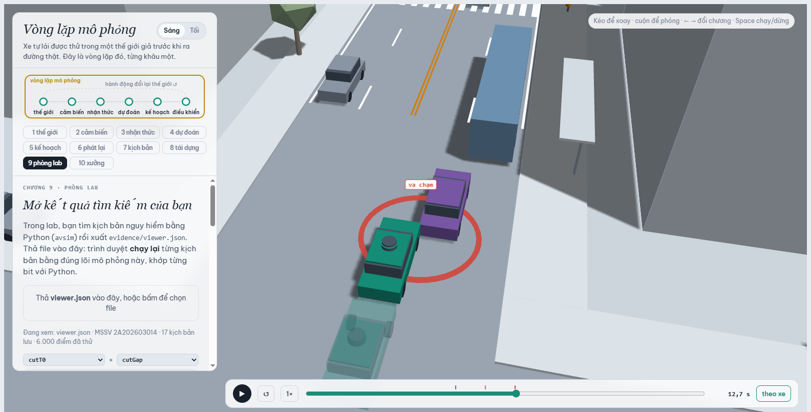
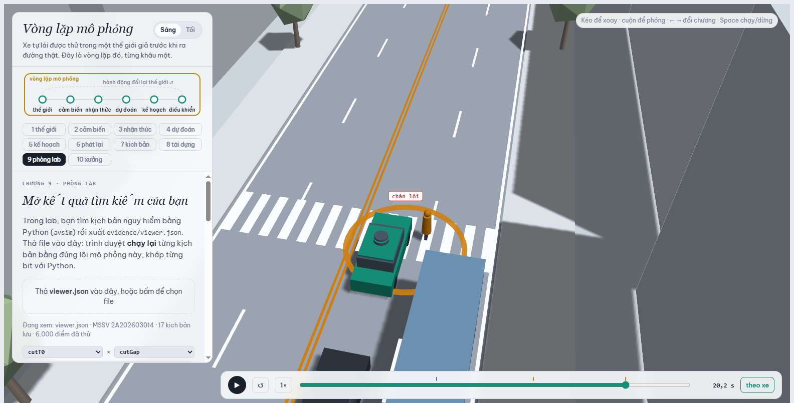
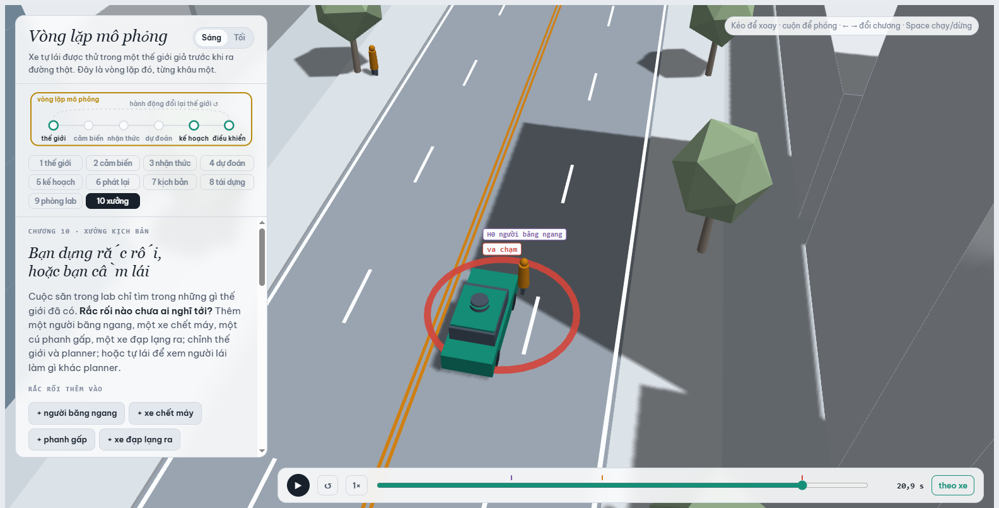
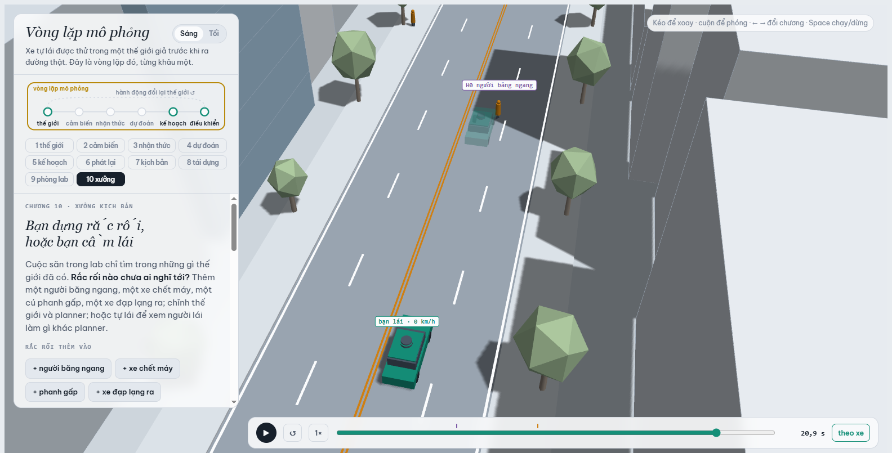

MSSV: 2A202603014

# Lab 11 · Scenario Forge — báo cáo

Học viên: **Nguyễn Đăng Thực** · MSSV **2A202603014**

Mỗi câu: trả lời ngắn, **trích số từ `evidence/`** (ghi tên file và trường, ví dụ `mc.json: crashes = 4`). Grader chạy lại với MSSV của bạn; số không khớp `evidence/` thì mất điểm phần D (RUBRIC), và câu dựa trên số sai khó được điểm đầy đủ. Không cần văn hay: một bảng nhỏ và hai, ba câu giải thích là đủ.

Thị trấn của bạn (`meta.json: _run.town`): **D** (khô hơn, người đi bộ cẩn thận hơn, nhiều "nhập làn rồi phanh": `p_bin = (0.15, 0.90, 0.20)`, `cutGap` trung vị 14 m).

> Ghi chú cách chạy: MSSV có chữ cái (`2A…`) nên regex `\d{6,12}` trong `run_all.py: mssv()` không đọc được dòng đầu file này. Tôi **không sửa** `run_all.py`; mọi lần chạy dùng biến môi trường mà grader cũng dùng: `LAB11_MSSV=2A202603014 python run_all.py …` (mọi file `evidence/*.json` có `_run.mssv = "2A202603014"`, `quick = false`).

## 1. Phát lại log có trung thực không? (bước A)

| `replay.json` | giá trị |
|---|---|
| `n` / `n_used` | 400 / 400 |
| `dropped_human_crash_logs` (log người lái tự gây va chạm, bị bỏ) | 0 |
| planner trên **log phát lại**: `replay.crashes` | **102** (`contact`: `rear` 94, `side` 8) |
| planner trong **thế giới phản ứng**: `reactive.crashes` | **0** |
| `crash_in_both` | 0 |

Gần như mọi va chạm khi phát lại là `rear`: xe phía sau (chủ yếu TG, xe bám đuôi; đôi khi C2 đã nhập làn phía sau xe ta, như R-01) chạy **đúng quỹ đạo đã ghi**, tức quỹ đạo nó đã lái khi bám theo **người lái** trong log. Planner chậm hơn người lái ở trước vạch bị xe buýt che (giới hạn `cautionV` 7,5 m/s, `T` = 1,6 s so với 1,1 s của người), nhưng TG trong log không biết planner đã phanh sớm hơn nên cứ thế lao vào đuôi. Đó là va chạm **giả** (`fake = true`): ngoài đời TG sẽ phản ứng. Bằng chứng là cùng 400 kịch bản đó trong thế giới phản ứng có 0 va chạm (`reactive.crashes = 0`, `crash_in_both = 0`). 8 vụ `side` có lẽ cùng một kiểu lỗi (tôi không kiểm tra từng vụ): xe C2 trong log nhập làn vào khe nó thấy cạnh **người lái**, không phải cạnh planner đang ở chỗ khác.

Ví dụ `replay_only`, kịch bản 10 (`tgT` = 0,62 s, TG bám rất sát): lúc 12–14 s planner ở chế độ thận trọng (vạch bị che) và giữ ≈ 7,2 m/s, trong khi người lái trong log chạy 9,3–9,7 m/s. Lúc 15 s planner nhường người đi bộ và phanh xuống 2 m/s, còn TG phát lại vẫn ≈ 5,6 m/s theo log, nên tông đuôi lúc 16,05 s. Trong thế giới phản ứng, TG tự giảm xuống 4,7 m/s và khoảng cách thời gian nhỏ nhất là `min_ttc_reactive = 2.62` s: không va chạm. Kịch bản này là R-03 trong chương 9 (phát lại với `others = "replay"`): `evidence/shots/ch9-R-03.png`, lúc 16,05 s TG phát lại chạm đuôi xe ta.

## 2. Kịch bản bất khả thi (bước B)

Luật trong `lab11/feasible.py: is_feasible` (loại nếu vi phạm **một** luật):

| Luật | Căn cứ vật lý |
|---|---|
| Đổi làn 3,5 m theo hình cosin trong `cutDur` giây có gia tốc ngang đỉnh a_lat = (π/cutDur)²·3,5/2; loại nếu a_lat > μg | Lực bám ngang của lốp không vượt μ·g (vòng tròn ma sát): 7,85 m/s² khi khô (μ = 0,8), 4,9 m/s² khi ướt (μ = 0,5). Đổi làn nhanh hơn thì xe trượt, không đổi làn được. |
| `cutBrake` > μg | Gia tốc phanh cũng bị giới hạn bởi ma sát: không xe nào phanh 8 m/s² trên đường ướt. |
| `pedV` > 2,5 m/s | Người **đi bộ** nhanh nhất cỡ 2–2,5 m/s; trên mức đó là chạy, ngoài mô hình người đi bộ của thị trấn (trung bình 1,35 m/s). |
| `cutV` ∉ (0, 22] m/s | Xe chuyển làn phải đang chạy (0 m/s thì không có "chuyển làn"), và 22 m/s ≈ 80 km/h là trần hợp lý cho phố đô thị này. |

Trong `hunt.json`, cuộc săn **`rear_ended`** sinh nhiều kịch bản bất khả thi nhất (`infeasible = 15`; `crosswalk_block` 4, `cut_in` 2, `bus_bypass` 0). Theo `cloud.json`, 14/15 vụ của nó vi phạm luật **gia tốc ngang khi đổi làn**, 10/15 trên đường ướt. Vì sao CEM bị kéo về đó: xe ta bị tông đuôi khi phải phanh gắt bất ngờ, và cú phanh gắt nhất đến từ một xe cắt vào **cực nhanh** (`cutDur` nhỏ) ngay trước mặt, càng nguy hiểm hơn khi đường ướt. Điểm nguy hiểm (TTC của TG) tăng khi `cutDur` giảm và khi đường ướt, nên CEM đẩy q đúng về phía biên ma sát rồi vượt qua nó. Kịch bản "nguy hiểm nhất" lại là kịch bản vật lý không cho phép.

Nếu **đếm** chúng là va chạm: (1) elite sẽ đầy kịch bản bất khả thi và CEM hội tụ vào vùng không có thật; (2) ước lượng IS cộng thêm các vụ không thể xảy ra nên bị **chệch lên**; (3) bước E sẽ chỉnh planner để chống những tình huống không tồn tại. Pipeline gán điểm `-inf` cho chúng và không bao giờ chạy hay đếm chúng.

## 3. Monte Carlo cho bạn biết gì (bước C1)

`mc.json`: **k = 2** (`crashes`), **n = 3000**, **p̂ = 6,67·10⁻⁴** (`p`), khoảng Wilson 95 % **[1,83·10⁻⁴; 2,43·10⁻³]** (`lo`, `hi`). Cả 2 vụ là `bus_bypass` (`modes`); 12 kịch bản bất khả thi không được chạy (`infeasible = 12`).

Muốn khoảng 95 % hẹp còn ±20 % của p: 1,96·√((1−p)/(n·p)) = 0,2, suy ra n = (1,96/0,2)²·(1−p)/p ≈ 96/p ≈ 96,04 × 0,99933 / 6,67·10⁻⁴ ≈ **1,44·10⁵ lần chạy**, gấp khoảng 48 lần 3 000 lần đã chạy.

Các kiểu **chưa hề xuất hiện** trong 3 000 lần: `cut_in`, `crosswalk_block`, `rear_ended` và `other` (`mc.json: per_mode.*.k = 0`). Không được báo 0. Con số đúng là **cận trên**: `per_mode.cut_in.hi` (và tương tự cho ba kiểu kia) = **1,28·10⁻³** (Wilson 95 % với k = 0, n = 3000; quy tắc số 3 cho 3/3000 = 1,0·10⁻³). Nghĩa là "nhỏ hơn khoảng 1,3·10⁻³", không phải "không bao giờ".

## 4. Importance sampling, ESS và độ suy biến (bước C3)

`estimate.json: seeds[s].per[mode]` (n = 600 mỗi ô, q = 0,8·CEM + 0,2·tự nhiên):

| kiểu | seed | `p` | `hits` | `ess` | `top_share` |
|---|---|---|---|---|---|
| bus_bypass | 0 | 2,46·10⁻⁴ | 51 | 146,5 | 0,173 |
| bus_bypass | 1 | 3,68·10⁻⁴ | 46 | 141,1 | 0,425 |
| bus_bypass | 2 | 4,28·10⁻⁴ | 59 | 125,7 | 0,410 |
| crosswalk_block | 0 | 1,28·10⁻⁷ | 31 | 115,1 | 0,151 |
| crosswalk_block | 1 | 7,07·10⁻⁷ | 30 | 118,3 | **0,632** |
| crosswalk_block | 2 | 5,90·10⁻⁷ | 31 | 119,7 | **0,542** |
| cut_in | 0 / 1 / 2 | 0 → cận `upper_zero_hits` = **2,5·10⁻²** | 0 / 0 / 0 | 115,1 / 127,1 / 136,4 | 0 |
| rear_ended | 0 / 1 / 2 | 0 → cận `upper_zero_hits` = **2,5·10⁻²** | 0 / 0 / 0 | 121,0 / 106,1 / 117,0 | 0 |
| **tổng** (`total`) | 0 / 1 / 2 | 2,47·10⁻⁴ / 3,68·10⁻⁴ / 4,28·10⁻⁴ (trung vị 3,68·10⁻⁴) | | | |

- **Ba seed có đồng ý không?** Với `bus_bypass` thì có: 2,5 đến 4,3·10⁻⁴, chênh dưới 2 lần. Cả ba nằm trong khoảng Wilson của Monte Carlo [1,83·10⁻⁴; 2,43·10⁻³] nhưng **thấp hơn** p̂ MC = 6,67·10⁻⁴, đúng cái bẫy "q hẹp nên ước lượng thường thấp" của README. `crosswalk_block` thì **không**: 1,3·10⁻⁷ đến 7,1·10⁻⁷, chênh 5,5 lần. MC không thấy vụ nào (cận 1,28·10⁻³), nên MC không mâu thuẫn, nhưng cũng không xác nhận được con số này.
- **`top_share` > 0,5** ở `crosswalk_block` seed 1 (0,632) và seed 2 (0,542): một mẫu duy nhất mang hơn nửa ước lượng. Khi đó p ≈ w_max/n gần như chỉ là trọng số p/q của **một** kịch bản, và đổi seed là đổi hẳn con số. Khoảng ±1,96·se cũng hẹp sai, vì se được tính từ chính vài mẫu nặng ký đó. Nguyên nhân: cuộc săn `crosswalk_block` không bao giờ có elite toàn va chạm (`hunt.json: crosswalk_block.stopped_tightening = false`, mức cuối −1,09), nên ước lượng dùng đề xuất **cuối cùng, hẹp nhất**. Đề xuất đó nằm ở một ngóc rất hiếm, nơi mọi trọng số đều nhỏ cỡ 10⁻⁸. Đây đúng là bẫy 3: cuộc săn tìm ra **một** cách va chạm, không phải cách hay xảy ra nhất. Vì vậy tôi coi 10⁻⁷ là con số **có thể thấp hơn sự thật nhiều**, không phải bằng chứng là kiểu này hiếm đến thế. `top_share` thấp (seed 0 = 0,15) cũng **không** chứng minh ước lượng đúng, vì q có thể bỏ sót hẳn vùng va chạm chính.
- **Kiểu 0 hits** (`cut_in`, `rear_ended`) được báo bằng cận trên `upper_zero_hits` = 3/(0,2·600) = 2,5·10⁻², không phải 0, và không dùng 3/ESS.
- **Ngân sách**: `budget = 16 800` lần chạy (4 kiểu × (8×300 săn + 3×600 ước lượng)). Riêng `bus_bypass`, một ước lượng IS tốn 2 400 + 600 = 3 000 lần chạy và đạt se/p ≈ 27 % (seed 0: se = 6,70·10⁻⁵) đến ≈ 45 % (seed 1, 2). Monte Carlo cần n ≈ (1−p)/(p·r²) để có cùng sai số tương đối r: với p ≈ 3,7·10⁻⁴, r = 0,27 thì n ≈ **37 000**, còn r = 0,45 thì n ≈ 13 000. IS rẻ hơn khoảng 4–12 lần. Với `crosswalk_block` ở mức 5·10⁻⁷ (nếu con số này đúng), MC cần cỡ 3/p ≈ 6·10⁶ lần chạy chỉ để **thấy** một vụ.
- **`other`** trong tổng lấy từ Monte Carlo C1 (`estimate.json: other = {k: 0, n: 3000, p: 0, hi: 1.28e-3, source: "mc.json"}`). Không có cuộc săn riêng cho `other`, vì nó là phần còn lại không thuộc kiểu nào và không có điểm nguy hiểm riêng để CEM leo. Vì k = 0 nên phần `other` đóng góp 0 vào `total` nhưng cộng cận 1,28·10⁻³ vào `hi` (seed 0: `hi` = 1,66·10⁻³), để tổng không giả vờ chắc chắn hơn dữ liệu.

## 5. Các kiểu thất bại (bước C2 + 3D)

Ảnh chụp trình xem 3D, chương 9 (`evidence/viewer.json`), dừng đúng khung va chạm hoặc chặn lối. Xe xanh đặc là policy gốc (các kịch bản này được tìm dưới policy gốc), bóng mờ là policy đã chọn ở bước E.

**`bus_bypass`, lách qua xe buýt** (`hunt.json: bus_bypass.found = {bus_bypass: 124}`; ảnh B-01..B-04):

Chuỗi sự kiện (B-01, 12,6 s; B-02..04 cũng ở 12,6–12,8 s): xe buýt đỗ ở làn ngoài E2 trước vạch qua đường. Xe C2 (tím) kẹt sau xe buýt, chậm lại dưới 6 m/s rồi lấn sang làn E1 của xe ta để vòng qua (B-01: khe chấp nhận 10 m; B-03: 5,8 m). Xe ta đang ở chế độ thận trọng vì vạch bị xe buýt che (≤ 7,5 m/s), nhưng chỉ coi C2 là "xe phía trước" khi C2 lệch ngang dưới `cutinLat` = 2,15 m so với tim xe ta. Lúc đó C2 đã ở ngay trước mũi xe và đi rất chậm, nên xe ta tông vào C2 lúc 12,6 s. Bóng mờ (`cutinLat` = 3,0) đã coi C2 là xe trước từ sớm nên dừng kịp phía sau.

**`crosswalk_block`, chặn lối người đi bộ** (`hunt.json: crosswalk_block.found = {crosswalk_block: 12, bus_bypass: 1}`; ảnh C-01..C-04):

Chuỗi sự kiện: cả 4 kịch bản đều có **đường ướt** (μ = 0,5) và **người đi bộ không ngó qua xe buýt**. CEM đã đẩy hai toạ độ nhị phân đó về phía nguy hiểm. P1 đứng ở lề, bị xe buýt che nên cảm biến xe ta không thấy. P1 chỉ xét những xe nó nhìn thấy, rồi bước ra từ trước đầu xe buýt. Xe ta chỉ thấy P1 khi P1 lộ ra, phanh hết cỡ ở 4,9 m/s² (đường ướt) và dừng được, nhưng thân xe đã nằm trên vạch. P1 phải đứng lại, thành sự kiện `block` (C-01: 20,2 s; C-02: 19,2 s; C-03: 21,0 s; C-04: 23,2 s). Bóng mờ (bản sửa) cũng chặn lối đúng lúc đó, vì `cutinLat` không liên quan đến người đi bộ.

**Không tìm thấy**: `cut_in` và `rear_ended`. Cuộc săn `cut_in` chỉ ra va chạm `bus_bypass` (`hunt.json: cut_in.found = {bus_bypass: 16}`), mức elite dừng ở −3,48 (TTC tốt nhất vẫn còn ≈ 3,5 s). Cuộc săn `rear_ended` ra `{bus_bypass: 2, crosswalk_block: 1}`, mức elite dừng ở −1,24. Tôi tin ở mức **trung bình** rằng hai kiểu này hiếm hơn hai kiểu kia: MC 0/3000 (cận 1,28·10⁻³) và IS 0 hits (cận 2,5·10⁻²) chỉ nói "dưới các cận đó", không nói "không thể". Một CEM 8 vòng × 300 mẫu cũng có thể đơn giản là chưa leo tới vùng đó.

**Nếu chỉ săn một lần chung cho mọi kiểu**: CEM co về kiểu dễ nhất. Bằng chứng ngay trong `hunt.json`: kể cả cuộc săn **nhắm** `cut_in` (điểm nguy hiểm là TTC tới C2) cũng trượt sang `bus_bypass` (16 vụ, 0 vụ `cut_in`). `bus_bypass` dễ đến mức cuộc săn riêng của nó ra 124 va chạm. Một cuộc săn chung sẽ dồn toàn bộ q vào vùng lách xe buýt, không bao giờ lấy mẫu vùng "đường ướt + không ngó + đúng thời điểm" của `crosswalk_block`. Kiểu đó khi ấy sẽ không có hit nào, và tổng bị đánh giá thấp. Vì vậy mỗi kiểu cần một cuộc săn riêng với điểm nguy hiểm riêng.

## 6. Sửa planner (bước E + 3D)

Policy được chọn (`fix.json: chosen.policy`): **`{"cutinLat": 3.0}`**: coi một xe đang lấn sang là xe phía trước ngay khi nó cách tim xe ta 3,0 m theo phương ngang (gốc là 2,15 m).

| | `fail` | `fail_hi_seen` | `fail_hi` | `unseen` | `progress` (m) | `harsh` (khung phanh > 3 m/s²) |
|---|---|---|---|---|---|---|
| policy gốc, TRAIN (`baseline_train`) | 4,77·10⁻⁴ | | 8,27·10⁻⁴ | – | 213,81 | 8,11 |
| `cutinLat 3.0`, TRAIN (`chosen`) | 1,67·10⁻⁵ | | 4,52·10⁻⁵ | `bus_bypass` | 214,01 | 7,60 |
| `cutinLat 3.0`, **TEST** (`chosen_test`) | **3,42·10⁻⁷** | **8,66·10⁻⁷** | **3,88·10⁻²** | `bus_bypass` | 215,92 | 7,83 |
| policy gốc, **TEST** (`baseline_test`) | **3,39·10⁻⁴** | **6,36·10⁻⁴** | **1,92·10⁻³** | – | 215,98 | 8,17 |

- TRAIN và TEST tách bạch: TRAIN chỉ để **sàng** (cùng 400 mẫu IS rút ở nơi **policy gốc** thất bại, seed `search + 11`). TEST dùng seed mới **và** một cuộc săn mới nhắm vào chính policy đó (`retarget`), cùng 3 000 kịch bản tự nhiên cho các va chạm khác (`chosen_test.other_crashes = {k: 0, n: 3000}`). Số tôi báo là số TEST.
- Trên TEST, bản sửa không còn `bus_bypass` nào (`chosen_test.bus_bypass.hits = 0`, so với 26 hits của policy gốc). Phần còn lại chỉ là `crosswalk_block` (27 hits, `p` = 3,42·10⁻⁷, giống hệt policy gốc, vì `cutinLat` không chạm tới logic người đi bộ).
- **Vì sao `fail_hi` của bản sửa (3,88·10⁻²) lớn hơn cả `fail` của policy gốc (3,39·10⁻⁴) dù bản sửa tốt hơn thật?** Vì bản sửa đã xoá hẳn `bus_bypass`, nên kiểu đó là `unseen` và chỉ còn cận hợp lệ cho 0 hit: `upper_zero_hits` = 3/(0,2·400) = 3,75·10⁻². Cộng cận `other` (1,28·10⁻³) và `crosswalk_block` (8,66·10⁻⁷) ra 3,88·10⁻². Cận này đo **ngân sách** (n = 400), không đo policy. Muốn chứng nhận dưới 10⁻³ thì cần cỡ 15 000 lần chạy trên đúng vùng đó. `fail_hi_seen` (8,66·10⁻⁷) mới là cái dữ liệu cho thấy, nhưng nó **không** phải cận của policy.
- Quãng đường: 215,92 m so với 215,98 m (mất 0,03 %, trong giới hạn 5 %). Phanh gấp **ít hơn**: 7,83 so với 8,17 khung mỗi lần chạy.

Ảnh có bóng mờ cho một kịch bản bản sửa tránh được (B-01 ở trên; B-02..04 tương tự): xe đặc là policy gốc tông C2 lúc 12,6 s, bóng mờ `cutinLat 3.0` dừng lại phía sau, không va chạm (`labRead`: "chính sách gốc: không va chạm" là bóng của bản sửa).

**Núm "nghe thì an toàn hơn" nhưng làm tăng thất bại: `T = 2.0`** (giữ khoảng cách thời gian 2,0 s thay vì 1,6 s). Trên cùng mẫu TRAIN (`fix.json: table`, hàng `{"T": 2.0}`): `fail` 5,76·10⁻⁴ so với 4,77·10⁻⁴ của policy gốc (`fail_hi` 1,05·10⁻³ so với 8,27·10⁻⁴); `bus_bypass` 33 hits so với 28, `crosswalk_block` 41 hits so với 19. Thế giới phản ứng lại: xe ta lùi xa xe trước hơn, nên **mở ra một khe lớn hơn** ngay trước mũi xe. C2 đang kẹt sau xe buýt quyết định nhập làn theo khe chấp nhận (`cutGap`) nên thấy khe đủ rộng thường hơn và lách vào đúng chỗ trống trước xe ta. Với `crosswalk_block`, tôi đoán (chưa kiểm tra riêng) là xe ta đến vạch muộn hơn nên hay trùng lúc P1 bước ra từ sau xe buýt hơn. Tương tự, `cautionV = 5.0` (đi rất chậm gần vạch) có `fail` thấp nhưng **tăng phanh gấp** lên 12,18 khung so với 8,11 và mất quãng đường (173,6 m < 95 % × 213,8 m), nên `choose_policy` loại nó.

## 7. Từ mô phỏng ra đường thật

| Giả định trong `avsim/space.py` (thị trấn D) | Dữ liệu thật thay thế, lấy từ đâu | Nếu sai thì con số của tôi sai theo hướng nào |
|---|---|---|
| **Khe chấp nhận của xe chuyển làn** `cutGap`: log-chuẩn, trung vị 14 m, σ = 0,5 | Quỹ đạo chuyển làn đo từ trên cao: highD/inD (drone, Đức), NGSIM US-101/I-80 (Mỹ). Với giao thông hỗn hợp Việt Nam cần tự quay drone/camera cao ở phố có điểm dừng xe buýt, rồi đo khe trước/sau lúc xe bắt đầu lệch làn. | Lái xe thật (nhất là ở Việt Nam) chấp nhận khe **ngắn hơn** 14 m thì p(`bus_bypass`) và p(`cut_in`) bị **đánh giá thấp**: đuôi trái của phân phối khe chính là nơi CEM tìm ra va chạm. |
| **Tỉ lệ người đi bộ ngó qua đầu xe buýt** `pedLook` = 0,90 | Video quan sát tại điểm dừng xe buýt: đếm người bước ra từ đầu xe buýt và có/không ngó trước khi bước. Bộ dữ liệu ý định qua đường như JAAD và PIE (York University) có nhãn hành vi nhìn/qua đường. | Nếu ít người ngó hơn 0,90 thì `crosswalk_block` hay xảy ra hơn: con số `crosswalk_block` của tôi bị **thấp**. Thị trấn D đã giả định người đi bộ cẩn thận nhất. |
| **Ma sát và tỉ lệ đường ướt**: μ = 0,5 khi ướt, 0,8 khi khô; `wet` = 0,15 | Đo hệ số bám mặt đường (thiết bị SCRIM, con lắc Anh) trên đúng loại bê tông nhựa của tuyến; số giờ mưa theo mùa từ dữ liệu khí tượng (Trung tâm Dự báo KTTV quốc gia). | Ở Hà Nội và TP.HCM mùa mưa, tỉ lệ thời gian đường ướt cao hơn 15 % và mặt đường mòn có thể dưới 0,5: quãng phanh dài hơn nên mọi xác suất va chạm bị **thấp**. Ma sát còn dời biên khả thi (bước B): μ thấp hơn thì nhiều kịch bản cắt làn gắt bị loại hơn. |

## 8. Giới hạn

1. **Một con phố, một kịch bản cố định**: 1 xe buýt, 1 vạch qua đường, 1 xe chuyển làn, 1 xe bám đuôi, 24 s. Xác suất tôi báo là "mỗi lần đi qua **đúng đoạn phố này**", không phải mỗi km hay mỗi giờ lái. Thế giới không có **xe máy**, trong khi xe máy chiếm đa số giao thông Việt Nam và là nguồn cắt mặt thường gặp nhất.
2. **Người lái khác chỉ là IDM + chấp nhận khe**: không phân tâm, không có thời gian phản xạ, không vi phạm luật, không phanh nhầm. Các vụ do lỗi người khác (vượt đèn, say rượu) không có trong p. Xe ta cũng chỉ **phanh**, không bao giờ đánh lái tránh.
3. **Cảm biến hoàn hảo** trừ phần bị xe buýt che: không nhiễu, không bỏ sót, không trễ. Riêng người đi bộ của bước G thì planner "thấy" xuyên qua các xe khác (chỉ P1 bị kiểm tra tầm nhìn). Ngoài đời phải cộng thêm lỗi nhận thức, nên p thật cao hơn.

Thêm một tuần, tôi sẽ: (a) thêm thời gian phản xạ và nhiễu nhận thức vào planner rồi đo lại `bus_bypass`; (b) hiệu chỉnh `cutGap` và `pedGap` bằng video drone ở một phố thật có điểm dừng xe buýt; (c) chạy khoảng 15 000 lần IS trên đúng vùng thất bại của policy đã sửa để chứng nhận nó dưới 10⁻³ (bước E hiện chỉ cho cận cỡ 10⁻²).

## 9. Rắc rối của bạn (bước G + chương 10)

- **Rắc rối:** một **người băng ngang giữa đoạn phố, ngoài vạch** (thẻ H0 loại "người băng ngang", từ lề phải `side = "S"`), sau vạch qua đường x = 122 m, ở x ∈ [130, 190] m. Ngoài đời, đó là người đi bộ băng thẳng sang quán, hàng rong hay cửa hàng bên kia đường thay vì đi bộ về vạch, rất phổ biến trên phố buôn bán ở Việt Nam. Theo thống kê của NHTSA (Mỹ), khoảng ba phần tư số người đi bộ tử vong bị đâm **ngoài giao lộ**, không phải ở vạch.
- **Căn cứ: vì sao tôi nghĩ planner xử lý kém.** Đọc `avsim/core.py`: mọi logic người đi bộ của planner (dự đoán `t_enter` < `t_arrive + pedBuffer` để nhường, tốc độ thận trọng `cautionV` khi vạch bị che) **chỉ áp dụng cho P1 ở vạch kẻ**. Mọi người đi bộ khác chỉ thành chướng ngại khi **đã vào hành lang ±1,9 m** quanh tim xe ta. Khi đó họ chỉ còn ≈ 0,4 s nữa là vào đường đi của xe, nên ở 10–12 m/s phanh hết cỡ cũng không kịp. Planner **không dự đoán** một người đang đi về phía làn mình. Ba núm `cautionV`, `pedBuffer`, `cutinLat` của bước E không chạm tới logic này, nên tôi dự đoán bản sửa không cứu được.
- **Giả định** (`hazard.json: space, exposure, why`):
  - `h0_x` ∈ [130, 190] m: đoạn 8–68 m sau vạch; dừng ở 190 vì trong 24 s xe ta chỉ đi tới x ≈ 204 m.
  - `h0_v` ∈ [1,0; 2,5] m/s: Knoblauch, Pietrucha & Nitzburg 1996 (TRR 1538) đo trung bình ≈ 1,5 m/s (người trẻ) và ≈ 1,3 m/s (≥ 65 tuổi), bách phân vị 15 của người già ≈ 1,0 m/s. Cận trên 2,5 m/s là người rảo bước hay chạy chậm, trùng ngưỡng "chạy" của `is_feasible`.
  - `h0_trig` ∈ [15, 60] m: khe thời gian 1,25–5 s ở ≈ 12 m/s, ngắn hơn khe trung vị 4,5 s mà người đi bộ ở vạch của thị trấn chấp nhận (`space.py: pedGap`).
  - `exposure` = **0,02 lần/chuyến** = 20 lượt băng ngang/giờ trên đoạn 60 m (**giả định**, chưa đo, cần đếm bằng camera) × cửa sổ xung đột 45 m / 12 m/s = 3,75 s / 3 600 s. Tôi cố ý không chọn 0,05 của ví dụ README.
- **Cảnh chính xác** (chương 10: x = 170 m, v = 1,6 m/s, bước xuống khi xe ta còn cách 44 m, thế giới mặc định của xưởng): `mine.json: exact.planner = [["ego", "H0", 20.9]]` (planner tông người đi bộ lúc 20,9 s, ở 27 km/h theo trình xem); `exact.you = []` (tôi lái thì không va chạm). Cảnh nằm trong giới hạn (`hazard_ok`, không cảnh báo).
- **Kết quả** (`mine.json`, 1 500 phiên bản trong giao thông thị trấn D):

| | policy gốc (`baseline`) | policy đã chọn `cutinLat 3.0` (`chosen`) |
|---|---|---|
| `accepted` | 0,9953 (1 493/1 500; 7 bất khả thi vì phần thế giới của thị trấn) | (cùng tập) |
| `crashes` (va chạm của xe ta) | 78 | 77 |
| **`avoidable`** (phanh hết cỡ ngay khi thấy là tránh được: lỗi planner) | **77** | **77** |
| `unavoidable` | 0 | 0 |
| `unattributed` (va chạm thường của thị trấn) | 1 | 0 |
| `low_speed` (xe ta < 1 m/s lúc chạm) | 2 | 2 |
| `avoidable_foreknown` | 77 | 77 |
| P(lỗi planner \| rắc rối) = `p` [Wilson 95 %] | **5,16·10⁻²** [4,15·10⁻²; 6,40·10⁻²] | **5,16·10⁻²** [4,15·10⁻²; 6,40·10⁻²] |
| tần suất mỗi chuyến `per_trip` (cận `per_trip_hi`) | **1,03·10⁻³** (1,28·10⁻³) | **1,03·10⁻³** (1,28·10⁻³) |

  - **Phân loại.** 77/78 va chạm là `avoidable`: cùng planner, nếu phanh hết cỡ ngay từ khung hình người đi bộ bắt đầu bước **và** cảm biến thấy họ thì không va chạm. Đây là lỗi của planner, không phải tình huống "ai cũng dính". Không có vụ `unavoidable`. 1 vụ `unattributed` là va chạm thường của thị trấn, xảy ra khi H0 chưa kích hoạt, nên không nói gì về rắc rối của tôi. Nó biến mất với bản sửa, phù hợp với việc bản sửa xoá `bus_bypass`, nhưng tôi không kiểm tra riêng vụ đó. `avoidable_foreknown` = `avoidable` = 77 vì người đi bộ bước ra từ lề phải, không bị che: trong cả 12 ví dụ, thời điểm phanh của người phanh hộ (`brake_t`) trùng thời điểm rắc rối bắt đầu (`fire_t`). Ở rắc rối này tầm nhìn bị che **không tốn gì**; lỗi hoàn toàn nằm ở việc planner không dự đoán.
  - **Bản sửa ở bước E không cứu:** 77 vụ `avoidable` với cả hai policy. Đặt cạnh tần suất lách xe buýt: `estimate.json` cho `bus_bypass` 2,5–4,3·10⁻⁴ mỗi chuyến (trung vị 3,68·10⁻⁴), `fix.json: baseline_test.bus_bypass.p` = 3,39·10⁻⁴. Người băng ngang (1,03·10⁻³ mỗi chuyến, với exposure giả định 0,02) đã cỡ **2–3 lần** lách xe buýt. Sau bản sửa, `bus_bypass` không còn hit nào trên TEST, nên rắc rối này trở thành **nguồn thất bại lớn nhất** của planner. Con số tỉ lệ thuận với `exposure`: nếu đếm thật ra 5 lượt/giờ thay vì 20 thì còn khoảng 2,6·10⁻⁴, ngang lách xe buýt.
  - **Vì sao "tránh được" là chuẩn lạc quan, theo hai hướng.** (1) Người phanh hộ **biết trước** rằng người kia sẽ băng qua ngay từ khung hình đầu tiên họ bước, phản xạ 0 s và phanh tối đa. Một planner thật không biết chắc mọi người bước xuống lề đều băng qua (phanh gấp cho mọi người đứng gần lề là vô số báo động giả), nên `avoidable` **đếm nhiều hơn** số vụ một planner thật tránh được: 77 là **cận trên** của lỗi planner theo nghĩa này. (2) Ngược lại, chỉ thử **phanh**, không thử đánh lái hay vừa phanh vừa lách. Một vụ "không tránh được bằng phanh" có thể tránh được bằng đánh lái, nên cách tính này **đếm ít đi** số vụ tránh được (ở đây `unavoidable` = 0 nên hướng này không đổi con số, nhưng nói chung có).
- **Hình:**

  Thêm: `evidence/shots/ch10-jaywalker-steps-out.png` (17,6 s: người bước xuống lề, xe ta còn 36 km/h; planner chưa phản ứng), `ch9-GB-01..03.png` và `ch9-GC-01..03.png` (ba vụ `avoidable` đầu tiên của `mine.json` với policy gốc và với bản sửa, phát lại trong chương 9).
- **Bạn tự lái thì sao:** trong chế độ "Bạn" của chương 10, tôi giữ nhịp như planner (cùng gia tốc), nhưng khi người đi bộ **bắt đầu bước xuống lề** (16,95 s) thì sau khoảng 1 s phản xạ tôi đạp phanh (−6 m/s²) và dừng hẳn, đợi họ qua rồi mới đi tiếp. Kết quả: không va chạm (`exact.you = []`; trình xem: "bạn lái: không va chạm"). Chuỗi bàn đạp nằm trong `hazard.json: egoAcc`. Khác biệt với planner: tôi phản ứng với **ý định** (một người đang đi về phía làn), còn planner chờ đến khi người đó **đã vào hành lang ±1,9 m** (≈ 20,4 s), muộn hơn khoảng 3,5 s. Đúng như README nhắc, tôi đã xem lại cảnh nhiều lần nên biết trước người đó sẽ băng qua; planner thì không.
- **Cách sửa:** không núm nào trong 9 núm sửa được. `cutinLat` chỉ áp dụng cho xe, còn `cautionV`, `pedBuffer` chỉ cho P1 ở vạch kẻ; bằng chứng là `chosen` vẫn 77 vụ `avoidable`. Planner cần thêm **logic mới**:
  1. **Dự đoán đường đi của mọi người đi bộ được phát hiện**, không chỉ P1: ngoại suy vận tốc hiện tại 2–3 s tới. Nếu đường đi cắt làn của xe ta thì áp dụng đúng phép nhường đang dùng cho P1 (`t_enter < t_arrive + pedBuffer`, chèn một "xe dẫn" ảo tại chỗ họ băng qua).
  2. **Thận trọng với người đang tiến về mép đường**: người đi bộ cách mép làn dưới khoảng 2 m và có vận tốc ngang hướng vào đường thì giới hạn tốc độ (kiểu `cautionV`), đến khi ý định rõ.
  3. Mở rộng hành lang người đi bộ từ ±1,9 m ra **cả bề rộng mặt đường** cho người đang di chuyển ngang. Đổi lại sẽ có nhiều lần giảm tốc thừa hơn, nên cần đo lại `progress` và `harsh` như bước E.
